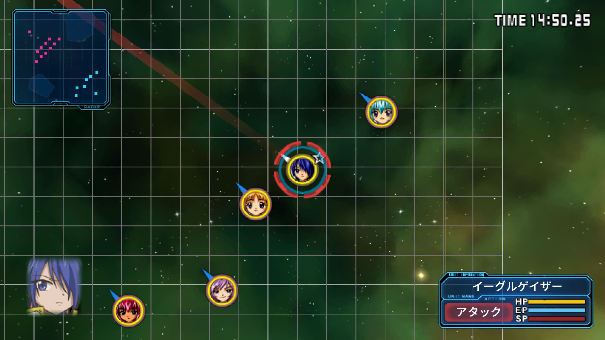
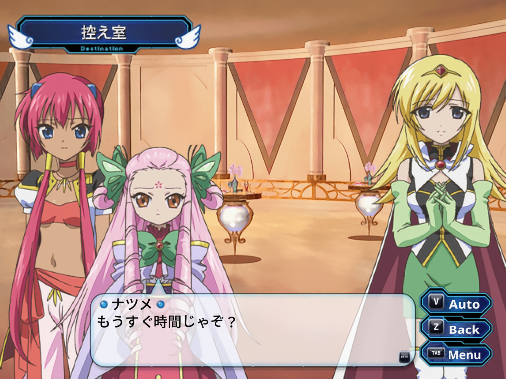

# Galaxy Angel II PC

[English](README.md) | **日本語**

[](https://github.com/ObeseCatLord/galaxy-angel-2-pc/actions/workflows/ci.yml)

<p align="center">
  
  
</p>
<p align="center"><sub>『永劫回帰の刻』、内部解像度 4 倍・Anime4K・デバンディング有効：16:9 ワイドの戦闘画面とストーリー場面。</sub></p>

プレイステーション 2 用『ギャラクシーエンジェルII』三部作
（『絶対領域の扉』『無限回廊の鍵』『永劫回帰の刻』）の PC ネイティブ移植です。
[PS2Recomp](https://github.com/ran-j/PS2Recomp) による静的リコンパイルで作られており、
Windows と Linux（x86-64 / ARM64）で動作します。

**ゲームのディスクイメージ（日本版 5 枚）はご自身でご用意ください。**
ゲームのデータは一切含まれていません。

## 遊び方

1. [Releases](../../releases) からお使いのシステム用のビルドをダウンロードして展開します。
2. `ga2`（Windows では `ga2.exe`）を起動します。
3. `.iso` ファイルをウィンドウにドラッグする（またはデータフォルダの `isos`
   フォルダに入れる）と、ゲームを選べるようになります。

Vulkan 1.3 対応の GPU が必要です。詳しい説明・全オプション・VR の案内は
[docs/PLAYING.md](docs/PLAYING.md)（英語）にあります。

## 主な機能

- 三部作すべてを一つのランチャーで。ディスクは自動で切り替わり、セーブデータは
  PS2 と同じく作品間で引き継がれます。
- 内部解像度 2 倍・4 倍、21:9 までのワイド画面（3D シーンは左右がより広く見えます）、
  ゲーム速度はそのままで最大 240 fps。
- キーボード・ゲームパッド・マウスだけでのプレイ（戦闘も含む）。ボタン表示は
  使っている機器に合わせて切り替わります。
- Ctrl 長押しでメッセージスキップ、Esc でムービースキップ。
- **英語翻訳を同梱：** オプション > Language で English を選ぶと、ストーリー・名前・
  メニュー・戦闘・翻訳済みの画像がすべて切り替わります。日本語にもいつでも戻せます。
  他の翻訳は言語パックとして追加できます
  （[docs/LANGUAGE_PACKS.md](docs/LANGUAGE_PACKS.md)）。
- MOD：差し替えファイルと高解像度テクスチャ（[docs/MODDING.md](docs/MODDING.md)）。
- 2D 画像用フィルター（Smooth、Anime4K、シャープ）、デバンディング、PS2 の
  ディザリングの除去。
- チートメニュー（F1）とゲーム内設定メニュー（F2）。
- OpenXR（SteamVR、Monado）による VR。ゲーム画面は大きなスクリーンに映り、
  3D シーンは周囲を立体視で包みます。
- Steam Frame 向けのネイティブ ARM64 ビルド（通常表示・VR とも対応、
  [docs/STEAM_FRAME.md](docs/STEAM_FRAME.md)）。

## 操作方法

| PS2 | キーボード | マウス |
| --- | --- | --- |
| 方向キー | 矢印キー / WASD | ホイール（メニュー） |
| ○（決定） | Enter、C | 左クリック |
| ×（キャンセル） | X、Space | 右クリック |
| □ / △ | Z / V | |
| L1 / R1 | Q / E | |
| L2 / R2 | 左 / 右 Shift | |
| L3 / R3 | R / F | 戻る / 進むボタン（戦闘中） |
| スタート | P | |
| セレクト（システムメニュー） | Tab | 中クリック |

ゲームパッドは通常の配置です。その他のキー：

| キー | 機能 |
| --- | --- |
| Ctrl（長押し） | メッセージスキップ |
| Esc | ムービースキップ |
| F1 | チート |
| F2 | 設定 |
| F11、Alt+Enter | フルスクリーン |

メニューはマウスポインターに追従します。戦闘中のマウス操作は
[docs/PLAYING.md](docs/PLAYING.md#playing-with-the-mouse)（英語）にまとめてあります。

### VR コントローラー

| PS2 | Quest、Rift、Pico、Reverb G2 | Index | Steam Frame |
| --- | --- | --- | --- |
| ○ / × | A / B | 右の A / B | B / A |
| □ / △ | X / Y | 左の A / B | X / Y |
| 方向キー・左スティック | 左スティック | 左スティック | 左スティック、十字キー |
| 右スティック | 右スティック | 右スティック | 右スティック |
| L1 / R1 | グリップ | グリップ | バンパー |
| L2 / R2 | 右スティックを左 / 右 | 右スティックを左 / 右 | グリップ |
| L3 / R3 | スティック押し込み | スティック押し込み | スティック押し込み |
| スタート | メニューを短く押す | 左トラックパッドを強く短く押す | メニューを短く押す |
| セレクト | メニュー長押し | 右トラックパッドを強く押す（または左を長押し） | View、またはメニュー長押し |
| ポイントしてクリック | トリガー | トリガー | トリガー |

- **画面の位置合わせ：** L1 と R1 を 1 秒間同時に押し続けます（多くのコントローラーでは
  両グリップ、Steam Frame では両バンパー）。
- **チートメニュー：** 両スティックを押し込みます。**Settings** の行から設定を開けます。
- **割り当て変更：** PS2 のボタンはそれぞれ独立したアクションなので、SteamVR の
  バインド画面でどれでも変更できます。
- **Windows Mixed Reality・Vive コントローラー：** 右トラックパッドを押した方向で
  ○・×・□・△ になります。Vive コントローラーには L2・R2・右スティックがありません。

詳しくは [docs/PLAYING.md](docs/PLAYING.md#vr)（英語）をご覧ください。

## ビルド方法

以下は Linux での手順です。Windows 版は Linux からクロスコンパイルします
（`tools/ci/build-windows-release.sh` を参照）。

必要なもの：clang、CMake、Ninja、Python 3、git、FFmpeg と Vulkan の開発パッケージ、
raylib が使う X11 の開発ライブラリ。

```bash
git clone --recursive https://github.com/ObeseCatLord/galaxy-angel-2-pc
cd galaxy-angel-2-pc

# パッチ適用済みの PS2Recomp と paraLLEl-GS は private/ に置かれます（git の管理外）。
tools/make_runtime_tree.sh
tools/fetch_parallel_gs.sh

# リコンパイラーをビルドします（初回のみ依存関係をダウンロード）。
python3 tools/ga2.py setup

# ディスクイメージをそれぞれのフォルダに置きます：
#   private/discs/zettai/   private/discs/mugen-1/   private/discs/mugen-2/
#   private/discs/eigou-1/  private/discs/eigou-2/
python3 tools/ga2.py import
python3 tools/ga2.py analyze
python3 tools/ga2.py generate
python3 tools/ga2.py build

python3 tools/package.py private/build/ga2-runtime dist
```

`dist/` にリリース版と同じ構成のフォルダができます。フルビルドには 16 コアで
約 1 時間かかります。

[CI ワークフロー](.github/workflows/ci.yml)は、プッシュのたびに Linux x86-64・
Linux ARM64・Windows でリコンパイラー・ランタイム・ランチャーをビルドしてテストします。
古いディストリビューションでも動く Linux ビルド（glibc 2.31 以降）は、Ubuntu 20.04 で
`tools/ci/build-linux-release.sh` を使って作れます。

## ライセンス

この移植のコードは PS2Recomp と同じく [GNU GPL v3](LICENSE) で公開しています。
ギャラクシーエンジェルII は © ブロッコリー です。本プロジェクトはブロッコリーおよび
ソニーとは関係ありません。
