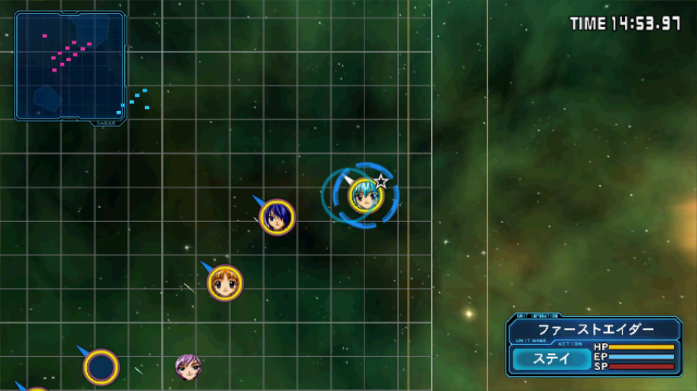
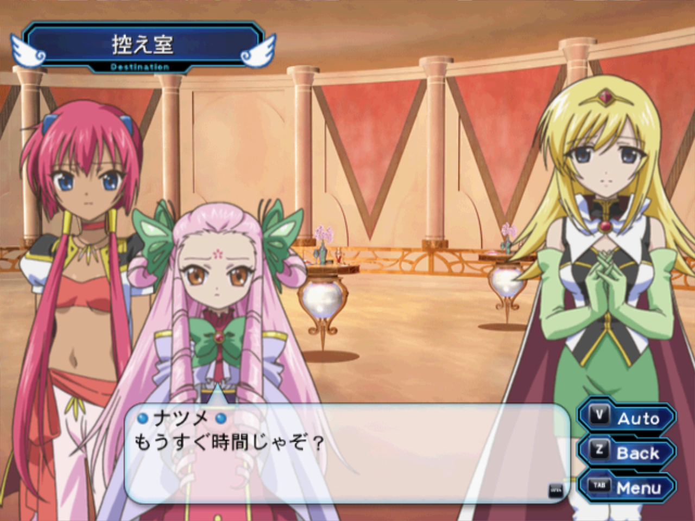

# Galaxy Angel 2 PC

[](https://github.com/ObeseCatLord/galaxy-angel-2-pc/actions/workflows/ci.yml)

<p align="center">
  
  
</p>

A native PC port of the Galaxy Angel II trilogy for the PlayStation 2:
*Zettai Ryouiki no Tobira*, *Mugen Kairou no Kagi* and *Eigou Kaiki no Toki*.
It is built with [PS2Recomp](https://github.com/ran-j/PS2Recomp) static
recompilation and runs on Windows and Linux (x86-64 and ARM64).

**You need your own disc images** of the Japanese releases (five discs). No
game data is included.

## Playing

1. Download the build for your system from
   [Releases](../../releases) and extract it.
2. Run `ga2` (`ga2.exe` on Windows).
3. Drag your `.iso` files onto the window, then pick a game.

You need a GPU with Vulkan 1.3. Details, all options and the VR guide are in
[docs/PLAYING.md](docs/PLAYING.md).

## Features

- One launcher for all three games. Discs change automatically, and saves
  carry over between the games as on the PS2.
- 2x and 4x internal resolution, widescreen up to 21:9 (the 3D scenes show
  more to the sides), and frame rates up to 240 fps at the original game
  speed.
- Keyboard, gamepad and full mouse play, including battles. Button prompts
  match the device you're using.
- Hold Ctrl to skip messages, Esc skips movies.
- Language switching: translations install as language packs (see
  [docs/LANGUAGE_PACKS.md](docs/LANGUAGE_PACKS.md)).
- Mods: replacement files and HD textures ([docs/MODDING.md](docs/MODDING.md)).
- Filters for the 2D art (Smooth, Anime4K, sharp pixels), debanding, and the
  PS2 dither turned off.
- Cheats menu (F1) and an in-game settings menu (F2).
- VR through OpenXR (SteamVR, Monado). The game is shown on a big screen,
  and the 3D scenes are drawn in stereo around you.

## Controls

| PS2 | Keyboard | Mouse |
| --- | --- | --- |
| D-pad | Arrows / WASD | wheel (menus) |
| Circle (confirm) | Enter, C | left click |
| Cross (cancel) | X, Space | right click |
| Square / Triangle | Z / V | |
| L1 / R1 | Q / E | |
| L2 / R2 | Left / Right Shift | |
| L3 / R3 | R / F | back / forward button (battles) |
| Start | P | |
| Select (system menu) | Tab | middle click |

Gamepads use their usual layout. Other keys:

| Key | Does |
| --- | --- |
| Ctrl (hold) | skip messages |
| Esc | skip a movie |
| F1 | cheats |
| F2 | settings |
| F11, Alt+Enter | fullscreen |

Menus follow the mouse pointer. The mouse controls in battles are listed in
[docs/PLAYING.md](docs/PLAYING.md#playing-with-the-mouse).

## Building

The build turns the games' own program code into C++, so it needs your disc
images. These steps are for Linux. Windows builds are cross-compiled from
Linux (see `tools/mingw-w64-toolchain.cmake`).

You need: clang, CMake, Ninja, Python 3, git, the FFmpeg and Vulkan
development packages, and the X11 development libraries raylib uses.

```bash
git clone --recursive https://github.com/ObeseCatLord/galaxy-angel-2-pc
cd galaxy-angel-2-pc

# The patched PS2Recomp and paraLLEl-GS go into private/ (git-ignored).
tools/make_runtime_tree.sh
tools/fetch_parallel_gs.sh

# Build the recompiler (downloads its dependencies once).
python3 tools/ga2.py setup

# Put each disc image in its own folder:
#   private/discs/zettai/   private/discs/mugen-1/   private/discs/mugen-2/
#   private/discs/eigou-1/  private/discs/eigou-2/
python3 tools/ga2.py import     # check and extract the discs
python3 tools/ga2.py analyze    # uses the function maps in configs/maps
python3 tools/ga2.py generate   # recompile the game programs to C++
python3 tools/ga2.py build      # compile the launcher and the five games

python3 tools/package.py private/build/ga2-runtime dist
```

`dist/` then holds the same folder as a release. A full build takes about
an hour on 16 cores.

The [CI workflow](.github/workflows/ci.yml) builds and tests the recompiler,
runtime and launcher on Linux x86-64, Linux ARM64 and Windows on every push.
The game programs need code generated from the discs, so the
[release workflow](.github/workflows/release.yml) reads that code from a
private repository. For portable Linux builds (glibc 2.31 and up), use
`tools/ci/build-linux-release.sh` on Ubuntu 20.04.

## License

The port's code is licensed under the [GNU GPL v3](LICENSE), like PS2Recomp.
Galaxy Angel II is © Broccoli. This project is not affiliated with Broccoli
or Sony.
